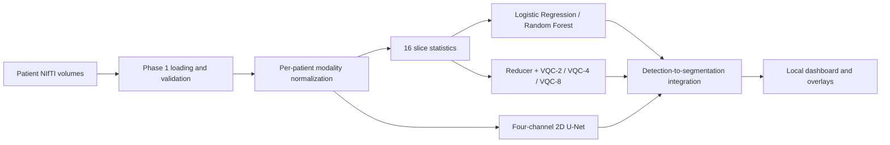

# Hybrid Quantum-Classical Brain Tumor Detection and Segmentation

## Project overview

This research and educational prototype combines BraTS MRI validation, slice-level classical and variational quantum classifiers, a four-channel 2D U-Net, and a local dashboard. Detection predicts whether an axial slice has any nonzero segmentation-label voxel. It does not diagnose a patient. The U-Net predicts a binary whole-tumor mask for selected slices. The system is not a clinical diagnostic device.

## Problem statement and objectives

Brain MRI provides complementary contrasts, while voxel-level tumor annotation and slice-wise review are labor intensive. This project implements an experimental pipeline to validate four-modality BraTS inputs, compare slice-level classifiers, explore small variational quantum classifiers, train a whole-tumor segmentation baseline, and demonstrate how detection can condition segmentation. It also preserves patient-separated validation and test cohorts and reports their limits.

## Dataset and modalities

The experiments use the BraTS-GLI 2023 training data available to this project, with 20 patient volumes in the current setup. Each patient has four co-registered 3D MRI modalities and a segmentation volume. Configured modality keys and display names are:

| Code | File suffix | Meaning in this project |
|---|---|---|
| T1C | `t1c` | T1-weighted post-contrast |
| T1N | `t1n` | Native T1-weighted |
| T2W | `t2w` | T2-weighted |
| T2F | `t2f` | T2-FLAIR |

BraTS data are not included. The loader expects patient folders named like `BraTS-GLI-<id>`, with each modality and a `seg` NIfTI file. Current code validates 3D dimensions, matching shape and geometry where applicable, finite numeric MRI values, and segmentation labels in `{0, 1, 2, 3}`. The binary segmentation target is `(seg > 0)`; class labels are not separately classified.

## System architecture



The component-level data flow and Mermaid diagrams are in [docs/architecture.md](docs/architecture.md). Installation, exact supported commands, and artifact requirements are in [docs/installation_and_execution.md](docs/installation_and_execution.md).

## Implemented phases

### Phase 1: loading and validation

`backend/data_loading.py` loads a patient’s four MRI volumes and segmentation volume. It records dimension mismatches and validates segmentation labels. Segmentation dataset construction also checks NIfTI header shape, affine, spacing, and orientation before lazy voxel loading.

### Phase 2: classical machine learning

`preprocessing/normalization.py` provides the z-score preprocessing used by the dataset builder and segmentation workflow. `feature_extraction/slice_features.py` extracts mean, standard deviation, median, and interquartile range for each of the four modalities (16 features per axial slice). `backend/dataset_builder.py` creates patient-level train, validation, and test splits. Logistic Regression and Random Forest use class-balanced fitting and validation-based reporting. The target is mask-positive versus zero-mask slice presence.

### Phase 3: quantum experiments

`models/quantum/` contains dimensionality reduction, PennyLane feature embedding and variational circuits, a VQC classifier, and the training/evaluation pipeline. Saved experiments include VQC-2, VQC-4, and VQC-8. VQC-16 is deferred and is not supported by the integrated application. The quantum experiments used 200 training samples while the classical estimators used 2,015 training slices; this is not a matched-budget comparison. No quantum advantage is claimed.

### U-Net segmentation

`models/segmentation/` implements a four-level 2D U-Net with four input channels, one output logit channel, and base width 16. The model uses convolution blocks with instance normalization and LeakyReLU, max-pooling, transposed-convolution upsampling, and skip connections. Training uses patient-grouped train/validation data, binary whole-tumor masks, and BCE + Dice loss. Inference applies the saved z-score normalization, predicts axial slices at the native 240×240 size, and thresholds probabilities at 0.5 for the frozen baseline.

### Detection-to-segmentation integration and dashboard

`models/integration/hybrid_pipeline.py` runs a selected detector over slices, then invokes the frozen U-Net for each positive slice and its clamped neighboring slices (default radius 1). No positive slices means segmentation is skipped. `dashboard/app.py` serves a standard-library HTTP application backed by that pipeline; the browser UI in `dashboard/static/` supports patient and modality selection, slice navigation, detector selection, detection plots, conditional segmentation, overlays, and validation model comparisons. The interactive patient list intersects detection-validation patients and checkpoint-validation patients, excluding test patients.

## Final held-out test results

These are the saved results from `results/final_test_evaluation_20261120T190221Z/`, evaluated on 465 slices from three held-out patients. The cohort has 13 train, 4 validation, and 3 test patients. Results below are detection metrics for mask-positive slice classification:

| Model | Accuracy | Precision | Recall | F1 | ROC-AUC |
|---|---:|---:|---:|---:|---:|
| Logistic Regression | 0.7247 | 0.5701 | 0.7722 | 0.6559 | 0.8644 |
| Random Forest | 0.7290 | 0.5714 | 0.8101 | 0.6702 | 0.8635 |
| VQC-2 | 0.3398 | 0.3398 | 1.0000 | 0.5072 | 0.5546 |
| VQC-4 | 0.7527 | 0.5947 | 0.8544 | 0.7013 | 0.7709 |
| VQC-8 | 0.7462 | 0.5901 | 0.8291 | 0.6895 | 0.7618 |

VQC-2 predicted every test slice positive (307 false positives and 158 true positives). Classical models were trained on 2,015 samples; quantum models on 200. This unequal-budget comparison does not establish model superiority or quantum advantage.

Standalone U-Net segmentation results on the same frozen test report are distinct from detection results and from the conditional hybrid pipeline:

| Standalone segmentation metric | Result |
|---|---:|
| All-slice macro Dice | 0.7414 |
| Tumor-slice macro Dice | 0.3970 |
| Patient-macro tumor Dice | 0.3946 |
| Global voxel Dice | 0.5862 |
| Global voxel IoU | 0.4147 |
| Pixel precision | 0.9654 |
| Pixel recall | 0.4209 |
| Empty-slice false-positive rate | 0.0814 |

Conditional hybrid metrics apply detection gating and therefore have a different evaluation scope. Full detection, standalone segmentation, hybrid, patient-level metrics, and saved visualizations are documented in [docs/final_experimental_results.md](docs/final_experimental_results.md), with raw reports retained under `results/`.

## Limitations and future scope

- The current experiment contains only 20 patients; three patients form the held-out test cohort, so estimates are highly uncertain.
- Slice-level detection identifies mask-positive slices, not patient-level disease or clinical diagnosis.
- Quantum and classical training sample counts differ; VQC-16 is deferred.
- Standalone U-Net pixel recall is low (0.4209), indicating substantial missed tumor pixels despite high pixel precision.
- More patient-level data, predeclared evaluation protocols, matched compute/data budgets, calibrated thresholds, robustness analyses, and external validation are needed before stronger research claims.
- This project is an educational/research prototype and is not intended for clinical use.

## Installation and execution

Use Python 3.11 in a virtual environment and install `requirements.txt`. Set the local dataset root in `config/settings.py` or use the supported local data directory layout. Existing saved experiments are loaded from their result folders; no model needs to be retrained for the dashboard when those artifacts are present. Run:

```powershell
python -m dashboard.app
```

Then open <http://127.0.0.1:8000>. The complete environment setup, dataset preparation, training commands, artifact checklist, and missing-artifact behavior are in [docs/installation_and_execution.md](docs/installation_and_execution.md).

## Reproducibility records

- Dataset split and feature manifest: `results/phase2_full_dataset_seed42/manifest.json`
- Classical validation run/configuration: `results/classical_baselines_seed42_20261118T170148_799890Z/`
- Quantum validation runs/configurations: `results/quantum_models_seed42_20261118T170214_243106Z/` and `results/quantum_models_seed42_20261118T171424_499965Z/`
- U-Net training configuration, history, metrics, checkpoint, and validation visualizations: `results/segmentation_runs/unet_baseline_20261120T173712Z/`
- Validation segmentation audits: `results/segmentation_validation_audit_20261120T181719Z/`
- Frozen final test report, model comparison, hashes, and visualizations: `results/final_test_evaluation_20261120T190221Z/`

Do not edit frozen run artifacts when reproducing or reviewing these results. See [docs/final_experimental_results.md](docs/final_experimental_results.md) for precise report references and metric definitions.
