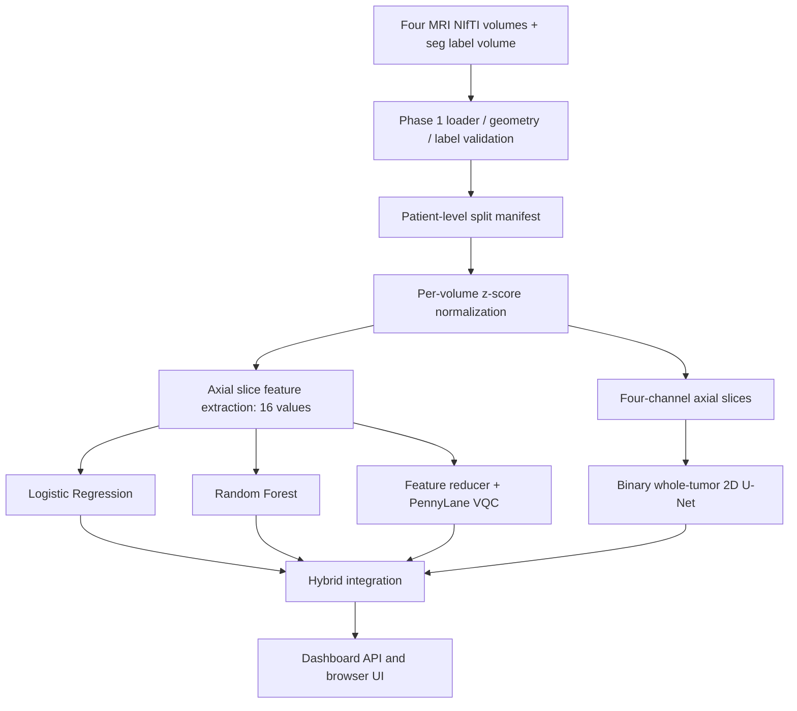
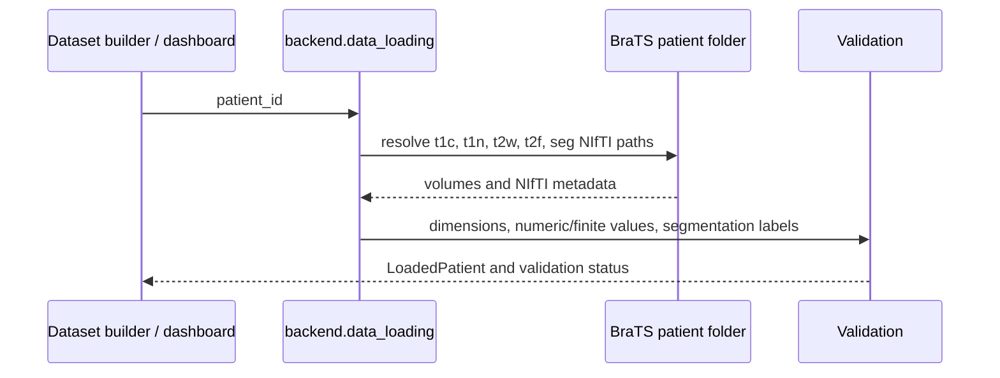
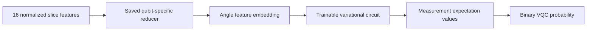
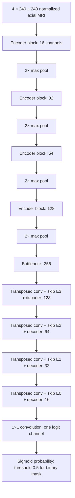
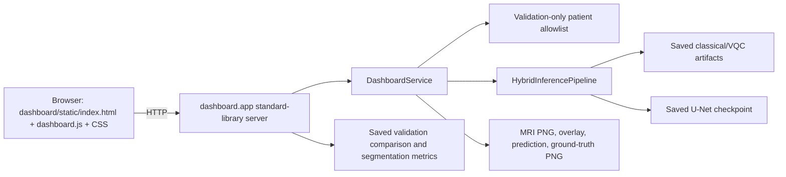

# System architecture

This document describes the checked-in implementation and saved configuration. The application runs inference from saved artifacts; training commands are separate workflows.

## 1. Overall system



The detection label is 1 if any voxel in the axial segmentation slice is nonzero, otherwise 0. Segmentation binarizes all nonzero BraTS labels into one whole-tumor mask.

## 2. Data ingestion flow



Patient input is expected in native 3D BraTS layout (the integrated segmentation path requires matching 240×240×Z volumes). `models/segmentation/dataset.py` separately validates NIfTI headers (shape, affine, spacing, orientation), restricts the segmentation training dataset to manifest `train` or `validation`, and lazily reads voxels by patient. The held-out test split is rejected by that dataset class.

## 3. Classical detection flow

```mermaid
flowchart LR
  A[One patient modality volume] --> B[Per-modality z-score normalization]
  B --> C[Axial slice; finite-voxel mask]
  C --> D[For each T1C/T1N/T2W/T2F: mean, std, median, IQR]
  D --> E[16 named feature columns]
  E --> F[Logistic Regression or Random Forest]
  F --> G[P(mask-positive slice)]
  G --> H[Class threshold 0.5]
```

`backend/dataset_builder.py` creates patient-level splits before exporting rows. `models/classical/train_baselines.py` fits class-balanced estimators on `train.csv`, reports on `validation.csv`, and does not load the test CSV. Features are the four statistics for each modality, not learned image embeddings.

## 4. Quantum detection flow



The implementation is in `models/quantum/embeddings.py`, `ansatz.py`, `dim_reduction.py`, and `vqc_model.py`. The pipeline loads a qubit-specific reducer together with its VQC artifact. VQC-2, VQC-4, and VQC-8 have saved runs and are supported by the integrated inference code. Although the training CLI has a broader default, VQC-16 is explicitly deferred and must not be presented as part of the supported integrated application. Quantum training used a sample limit of 200 in the reported experiments.

## 5. U-Net encoder-decoder



Each encoder/decoder block uses two 3×3 convolutions, instance normalization, and LeakyReLU. Encoder downsampling is 2× max pooling; decoder upsampling is 2× transposed convolution with concatenated skip features. The source is `models/segmentation/unet.py`. Targets are binary `(seg > 0)`. The training loss is the equal-weight sum of binary cross-entropy-with-logits and soft Dice loss. Training batches are patient-local, and the checkpoint is selected by validation all-slice Dice in the recorded run.

## 6. Conditional segmentation flow

```mermaid
sequenceDiagram
  participant UI as Dashboard request
  participant Pipe as HybridInferencePipeline
  participant Det as Selected slice detector
  participant Net as Saved U-Net checkpoint
  UI->>Pipe: patient modalities + detector choice
  Pipe->>Pipe: normalize all four volumes; extract per-slice features
  loop requested axial slices
    Pipe->>Det: 16 features
    Det-->>Pipe: positive-class probability and class at 0.5
  end
  alt one or more positive slices
    Pipe->>Pipe: select each positive slice and clamped neighbors (radius 1)
    Pipe->>Net: selected four-channel axial images
    Net-->>Pipe: probability maps and binary masks at 0.5
  else no positive slices
    Pipe-->>UI: skipped_no_positive_slice
  end
  Pipe-->>UI: detections, selected indices, segmentation outputs
```

The standalone U-Net metrics evaluate the U-Net over all test slices. Conditional hybrid metrics evaluate masks after detector gating; a detector false negative prevents that slice from reaching the U-Net, while neighbor selection can include nearby slices. These are separate evaluation scopes.

## 7. Dashboard architecture



The patient allowlist is the intersection of patient IDs in `validation.csv` and the U-Net checkpoint's `validation_patient_ids`. The dashboard loads MRI and ground truth only after a permitted patient is selected. It does not use test CSV entries to populate the selector. APIs expose patient list, model comparison, validation segmentation metrics, slice analysis, modality images, and selected segmentation images. The browser displays the selected modality/slice, detector probabilities, positive/negative counts, U-Net outputs, and overlay. Comparison charts use saved validation metrics, not final test metrics.
