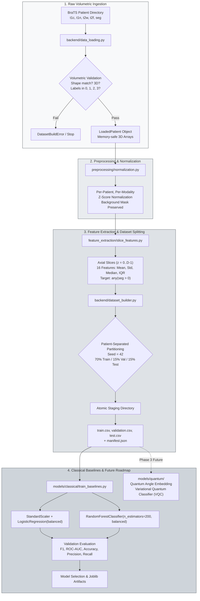
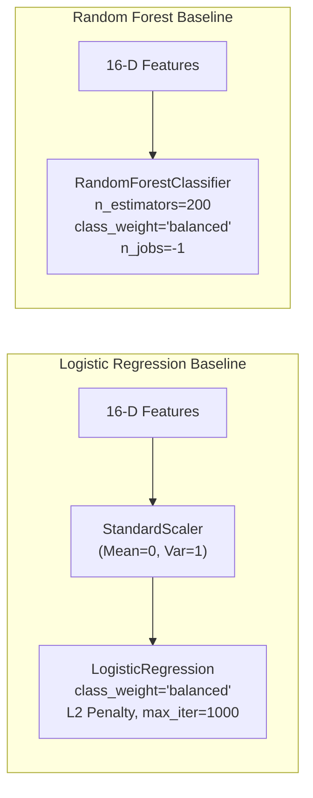
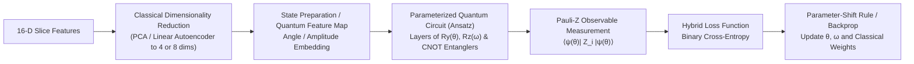

# Hybrid Quantum-Classical Brain Tumor Detection: Comprehensive Technical Project Report

---

## 1. Executive Summary & Project Overview

### 1.1 Project Objective
The **Hybrid Quantum-Classical Brain Tumor Detection** project establishes a rigorous, scalable, and reproducible machine learning pipeline designed to detect the presence of brain tumors from multi-parametric Magnetic Resonance Imaging (mpMRI) scans. By transforming complex, volumetric 3D neuroimaging data into standardized axial slice representations and deterministic statistical feature vectors, the project constructs a robust bridge between high-dimensional clinical imaging and machine learning classifiers.

```
+---------------------------------------------------------------------------------------------------+
|                                  PROJECT IMPLEMENTATION PHASES                                    |
+---------------------------------------------------------------------------------------------------+
| [X] Phase 1: Ingestion & Integrity   --> NIfTI volumetric validation, label checks, memory safety |
| [X] Phase 2: Feature & Classical ML  --> 16-D feature extraction, patient splits, LR & RF models   |
| [ ] Phase 3: Hybrid Quantum ML       --> Quantum embeddings, VQC ansatz circuits (Reserved)       |
+---------------------------------------------------------------------------------------------------+
```

### 1.2 Current Implementation Status
The project currently implements the complete **classical foundation** (Phases 1 and 2):
1. **Volumetric Data Ingestion & Validation Engine**: Single-patient memory-safe loading of 4 MRI modalities and segmentation ground truth with strict dimension and label verification.
2. **Preprocessing & Intensity Normalization**: Robust per-patient, per-modality z-score and min-max normalization handling background voxels without bias.
3. **Statistical Slice Feature Extraction**: A 16-dimensional tabular feature representation capturing central tendency and dispersion across all modalities per axial slice.
4. **Patient-Separated Dataset Builder**: Leakage-free dataset splitting (70% train, 15% validation, 15% test) with atomic, transactional disk writes and structured metadata manifests.
5. **Classical Machine Learning Baselines**: Balanced Logistic Regression and Balanced Random Forest classifiers evaluated on validation slices under strict data isolation.
6. **Future Quantum Architecture**: The `models/quantum/` module is structurally mapped and reserved for Phase 3 integration (Variational Quantum Classifiers and Quantum Neural Networks).

### 1.3 Scope and Research Boundaries
To ensure scientific clarity and medical integrity, the project defines its exact task boundaries:
- **Target Task**: **Slice-level mask presence classification**. An axial slice is assigned binary target $y = 1$ if its ground-truth segmentation mask contains any non-zero voxel ($\sum \text{mask} > 0$), and $y = 0$ if the slice is devoid of tumor tissue.
- **Clinical Boundary**: This system performs slice-level screening and pre-filtering. It is an experimental developmental framework and **not** a diagnostic device, a patient-level prognosis engine, or a full 3D voxel-level tumor segmentation model.

---

## 2. Dataset Architecture & Clinical Context

### 2.1 The BraTS 2023 Adult Glioma Challenge (BraTS-GLI)
The pipeline is designed around the **ASNR-MICCAI Brain Tumor Segmentation (BraTS) 2023 Adult Glioma** dataset. Gliomas represent the most common primary brain malignancies in adults, characterized by heterogeneous cellular morphology, aggressive infiltration, and diffuse margins.

### 2.2 Multi-Parametric MRI (mpMRI) Modalities
For each patient, four co-registered and skull-stripped 3D NIfTI (`.nii.gz` / `.nii`) volumes are acquired, each reflecting distinct biophysical tissue properties:

| Modality Suffix | Clinical Description | Biophysical Contrast & Utility |
| :--- | :--- | :--- |
| `t1n` | $T_1$-weighted Native (pre-contrast) | Baseline anatomical architecture; gray-matter versus white-matter contrast. |
| `t1c` | $T_1$-weighted Contrast-Enhanced (Gd) | Demonstrates blood-brain barrier disruption; delineates actively vascularized, enhancing tumor boundaries. |
| `t2w` | $T_2$-weighted | Highlights fluid accumulation and water content; reveals vasogenic edema and bulk lesion boundaries. |
| `t2f` | $T_2$-FLAIR (Fluid Attenuated Inversion Recovery) | Suppresses free cerebrospinal fluid (CSF) signal to distinguish peritumoral hyperintense edema from brain ventricles. |

### 2.3 Segmentation Ground Truth Labels
The segmentation volume (`seg`) contains expert neuroradiologist annotations mapped to four discrete integer labels:

$$\text{Label}(x, y, z) \in \{0, 1, 2, 3\}$$

- **Label 0 (`NET` / Background)**: Normal brain parenchyma or exterior background.
- **Label 1 (`NCR` / Necrotic Tumor Core)**: Non-enhancing, necrotic or cystic tumor core.
- **Label 2 (`ED` / Peritumoral Edema)**: Peritumoral edematous, infiltrating tissue.
- **Label 3 (`ET` / Enhancing Tumor)**: Active, contrast-absorbing tumor margin.

### 2.4 Project Configuration and Data Layout
Global storage locations are managed centrally in `config/settings.py`:
- `DATASET_ARCHIVE_PATH`: Raw downloaded archive (`ASNR-MICCAI-BraTS2023-GLI-Challenge-TrainingData.zip`).
- `DATASET_ROOT`: Extracted directory containing individual patient subdirectories (`BraTS-GLI-XXXXX-XXX/`).
- `RESULTS_DIR`: Output destination for generated datasets and baseline metrics.
- `MODELS_DIR`: Directory housing classical models and future quantum models.

---

## 3. End-to-End Pipeline Architecture

The overall system architecture processes raw 3D patient volumes through validation, normalization, feature extraction, dataset generation, and model training.



---

## 4. In-Depth Module Breakdown

### 4.1 Data Ingestion & Integrity Validation (`backend/data_loading.py`)
Processing volumetric medical imaging requires strict memory management and stringent shape checking. Loading entire cohorts into RAM simultaneously causes out-of-memory crashes. `data_loading.py` implements a streaming, single-patient loading paradigm.

#### Key Mechanics:
- **`_resolve_volume_path(patient_dir, suffix)`**: Resolves `.nii.gz` or `.nii` files for each modality. Throws informative errors if files are absent or duplicated.
- **Single Patient Memory Footprint**: Loads exactly one patient at a time using `nibabel.load(path).dataobj` without unnecessary caching.
- **Volumetric Consistency Verification**:
  - Confirms all 5 volumes (`t1c`, `t1n`, `t2w`, `t2f`, `seg`) have identical spatial shapes (typically $240 \times 240 \times 155$).
  - Validates that volumes are strictly 3-dimensional ($N = 3$).
- **Ground Truth Mask Integrity**:
  - Checks that all segmentation labels belong to $\text{EXPECTED\_SEGMENTATION\_LABELS} = \{0, 1, 2, 3\}$.
  - Rejects NaNs, infinities, or non-integer floats.
- **The `LoadedPatient` Dataclass**:
  ```python
  @dataclass(frozen=True)
  class LoadedPatient:
      patient_id: str
      volumes: Mapping[str, np.ndarray]
      source_paths: Mapping[str, Path]
      shape_mismatches: Mapping[str, tuple[int, ...]]
      non_3d_volumes: tuple[str, ...]
      segmentation_labels: tuple[int | float, ...]
      invalid_segmentation_labels: tuple[int | float, ...]
      segmentation_has_non_finite_values: bool
  ```

---

### 4.2 Preprocessing & Intensity Normalization (`preprocessing/normalization.py`)
Raw MRI voxel intensities do not possess standardized units (unlike Hounsfield Units in CT scans). Intensities vary across scanners, magnetic field strengths, and patient tissue characteristics.

#### Mathematical Normalization Formulation:
1. **Z-Score Normalization (Standardization)**:
   Given foreground voxel set $\Omega_{fg}$ with finite intensities $X$:
   $$\mu = \frac{1}{|\Omega_{fg}|} \sum_{i \in \Omega_{fg}} X_i, \quad \sigma = \sqrt{\frac{1}{|\Omega_{fg}|} \sum_{i \in \Omega_{fg}} (X_i - \mu)^2}$$
   $$X_{\text{norm}}(i) = \begin{cases} \frac{X_i - \mu}{\sigma}, & \text{if } i \in \Omega_{fg} \text{ and } \sigma > 0 \\ 0, & \text{otherwise} \end{cases}$$

2. **Min-Max Scaling**:
   $$X_{\text{norm}}(i) = \frac{X_i - \min(X)}{\max(X) - \min(X)}$$

#### Background Handling Strategy:
In neuroimaging, background voxels (air outside the skull) typically have zero intensity. However, naive normalization that automatically discards all zero voxels introduces bias if zero values naturally occur within normalized brain tissue. `normalize_mri` accommodates explicit boolean background masks (`background_mask`), ensuring only true background voxels are excluded while preserving all finite parenchyma voxels.

---

### 4.3 Statistical Slice Feature Extraction (`feature_extraction/slice_features.py`)
Rather than training directly on raw, uncurated 2D slices (which requires massive computational infrastructure and risks severe overfitting), the framework extracts a compact, highly interpretable 16-dimensional feature vector for each axial slice.

#### 16-Feature Vector Layout:
For each axial slice index $z \in \{0, \dots, D-1\}$, features are extracted across the 4 modalities in deterministic order:

$$\mathbf{F}_{\text{slice}} = \left[ f_{\text{t1c}}, f_{\text{t1n}}, f_{\text{t2w}}, f_{\text{t2f}} \right] \in \mathbb{R}^{16}$$

Where for each modality $m$, the 4 statistics are:
1. **Mean**: $\mu_m = \frac{1}{N} \sum_{j=1}^N x_{m,j}$ (Measures baseline tissue density/enhancement).
2. **Standard Deviation**: $\sigma_m = \sqrt{\frac{1}{N} \sum_{j=1}^N (x_{m,j} - \mu_m)^2}$ (Measures structural heterogeneity).
3. **Median**: $Q_{2,m}$ (Robust central measure insensitive to extreme outlier artifacts).
4. **Interquartile Range (IQR)**: $\text{IQR}_m = Q_{3,m} - Q_{1,m}$ (Measures robust statistical spread).

```
Feature Index Breakdown:
[0..3]   t1c_mean, t1c_std, t1c_median, t1c_iqr
[4..7]   t1n_mean, t1n_std, t1n_median, t1n_iqr
[8..11]  t2w_mean, t2w_std, t2w_median, t2w_iqr
[12..15] t2f_mean, t2f_std, t2f_median, t2f_iqr
```

#### Binary Target Formulation:
The axial ground truth label $y \in \{0, 1\}$ is determined strictly by mask presence:

$$y = \begin{cases} 1, & \text{if } \exists (x, y) \text{ such that } \text{seg}[x, y, z] > 0 \\ 0, & \text{otherwise} \end{cases}$$

---

### 4.4 Patient-Separated Dataset Builder (`backend/dataset_builder.py`)

#### Preventing Data Leakage:
A critical pitfall in medical image classification is **slice-level data leakage**, where slices from the same patient are distributed across both training and validation/test splits. Because adjacent slices within a patient exhibit intense spatial and anatomical correlation, models tested on slices from trained patients achieve falsely inflated metrics that collapse during clinical deployment.

`dataset_builder.py` guarantees **strict patient-level separation**:
1. All unique patient identifiers (`BraTS-GLI-XXXXX-XXX`) are enumerated.
2. Patients are shuffled with a fixed random seed (`seed = 42`).
3. Disjoint partitions are created according to ratios:
   - **Training Set**: 70% of patients
   - **Validation Set**: 15% of patients
   - **Test Set**: 15% of patients
4. Every slice belonging to a patient is stored strictly in that patient's designated split CSV.

#### Atomic Write Transaction Pattern:
To prevent corrupt or partial datasets resulting from runtime interruptions, data is written to a temporary staging directory (`.output.building-XXXX`). Upon successful completion of all patients, the staging directory is atomically renamed to the target destination. If an error occurs, the staging directory is automatically deleted, leaving the filesystem clean.

#### Manifest File (`manifest.json`):
Every build outputs a metadata manifest documenting:
- Random seed and exact split ratios.
- Disjoint patient assignment lists per split.
- Feature column schema and normalization policies.
- Per-split class distributions (counts of zero-mask vs. mask-positive slices).

---

## 5. Classical Machine Learning Baselines (`models/classical/train_baselines.py`)

### 5.1 Estimator Architectures

The classical modeling pipeline implements two complementary statistical learning algorithms:



1. **Balanced Logistic Regression Pipeline**:
   - `StandardScaler()`: Computes training feature means and variances, normalizing inputs before linear optimization.
   - `LogisticRegression(class_weight='balanced', max_iter=1000, random_state=seed)`: Automatically balances class weights inversely proportional to class frequencies:
     $$w_k = \frac{N}{2 \cdot N_k}$$
   - Serves as the linear baseline benchmark.

2. **Balanced Random Forest Classifier**:
   - `RandomForestClassifier(n_estimators=200, class_weight='balanced', n_jobs=-1, random_state=seed)`:
   - Constructs an ensemble of 200 de-correlated decision trees.
   - Captures non-linear feature interactions (e.g., elevated $T_2\text{-FLAIR}$ variance paired with high $T_1\text{c}$ median) without requiring input feature scaling.

### 5.2 Split Isolation & Evaluation Protocol
The model training workflow strictly enforces split boundaries:
- **`train.csv`**: Used exclusively to fit estimators and scalers.
- **`validation.csv`**: Used exclusively to evaluate and compare models.
- **`test.csv`**: **Completely unread and unvisited**. This split is reserved for final unbiased benchmark testing.

### 5.3 Performance Metrics & Selection Logic
Validation metrics are computed using `scikit-learn`:
- **Accuracy**: Overall fraction of correct slice classifications.
- **Precision**: $\frac{TP}{TP + FP}$ (Reliability of positive tumor calls).
- **Recall (Sensitivity)**: $\frac{TP}{TP + FN}$ (Ability to detect all tumor slices; clinically vital).
- **$F_1$-Score**: Harmonic mean of Precision and Recall:
  $$F_1 = 2 \cdot \frac{\text{Precision} \cdot \text{Recall}}{\text{Precision} + \text{Recall}}$$
- **ROC-AUC**: Area Under the Receiver Operating Characteristic Curve based on predicted class probabilities.
- **Confusion Matrix**: Full breakdown of true negatives, false positives, false negatives, and true positives.

**Model Selection Rule**: Models are ranked deterministically by the tuple $(F_1, \text{ROC-AUC}, \text{Accuracy})$. The winning estimator and validation report are serialized to disk (`results/classical_baselines_seed42_<timestamp>/`).

---

## 6. Future Hybrid Quantum Architecture Roadmap (`models/quantum/`)

The repository includes a designated module `models/quantum/` reserved for Phase 3. The integration of Quantum Machine Learning (QML) onto the established classical feature foundation is detailed below.

### 6.1 Motivation for Quantum Classifiers
While deep neural networks require thousands of parameters, Parameterized Quantum Circuits (PQCs) can generate expressive, non-linear decision boundaries within high-dimensional Hilbert space ($\mathcal{H}$) using relatively few qubits and variational parameters, offering high parameter efficiency for low-dimensional tabular descriptors.

### 6.2 Quantum Pipeline Architecture



### 6.3 Technical Implementation Plan for Phase 3:
1. **Feature Dimensionality Reduction**:
   - Current Noisy Intermediate-Scale Quantum (NISQ) simulators operate effectively on 4 to 8 qubits.
   - A classical trainable pre-layer or PCA projection will map the 16 features down to $N_q = 4$ or $N_q = 8$ normalized angles $\theta_i \in [-\pi, \pi]$.
2. **Quantum Feature Encoding**:
   - **Angle Embedding**: Rotating qubits along the Y and Z axes using $R_y(x_i)$ and $R_z(x_i)$.
   - **Entanglement Layer**: Using circular or all-to-all CNOT gates to construct multi-qubit quantum correlations.
3. **Variational Quantum Classifier (VQC) Ansatz**:
   - Strongly entangling layers or hardware-efficient ansatz circuits parameterized by variational rotation angles $\boldsymbol{\theta}$.
4. **Hybrid Optimization**:
   - Framework: **PennyLane** or **Qiskit Machine Learning** interfacing with PyTorch.
   - Gradient computation via the **parameter-shift rule**:
     $$\frac{\partial \langle M \rangle}{\partial \theta_j} = \frac{\langle M \rangle_{\theta_j + \frac{\pi}{2}} - \langle M \rangle_{\theta_j - \frac{\pi}{2}}}{2}$$

---

## 7. Testing, Verification & Quality Assurance Suite

The codebase enforces software engineering standards through an isolated unit-testing framework (`tests/`):

| Test Module | Coverage Scope | Verified Behaviors |
| :--- | :--- | :--- |
| `test_normalization.py` | `preprocessing/normalization.py` | Volume dimension preservation, rejection of non-3D inputs, proper z-score scaling, handling of constant/empty foregrounds, non-finite voxel exclusion, explicit background masking. |
| `test_slice_features.py` | `feature_extraction/slice_features.py` | 16-feature ordering, correct statistical computation (Mean, Std, Median, IQR), rejection of non-numeric or mismatched arrays, binary target assignment without label misinterpretation. |
| `test_dataset_builder.py` | `backend/dataset_builder.py` | Deterministic patient assignment for fixed seeds, complete partition disjointness, rejection of invalid split ratios or insufficient patients, atomic staging and rollback on failure. |
| `test_classical_baselines.py` | `models/classical/train_baselines.py` | Verification that model features exclude patient metadata, validation that models train strictly on `train.csv` without reading `test.csv`, metric calculation correctness. |
| `verify_phase2_setup.py` | System Environment | Verifies local directory paths, existence of BraTS archive and patient folders, and modality suffix completeness. |

---

## 8. Step-by-Step Execution & Reproduction Guide

### 8.1 Environment Setup (Windows PowerShell)
Create a Python 3.11 virtual environment and install project requirements:

```powershell
# Navigate to the repository root
cd "c:\Users\Vikas Anjutagi\OneDrive\Desktop\mini prolect\Hybrid_Brain_Tumor_Project"

# Initialize and activate the virtual environment
py -3.11 -m venv .venv
.\.venv\Scripts\Activate.ps1

# Install dependencies
python -m pip install -r requirements.txt
```

### 8.2 Executing the Test Suite
Run all unit tests across the project:

```powershell
python -m unittest discover -s tests -v
```

### 8.3 Generating the Dataset Splits
Extract patient features and create patient-separated train, validation, and test sets:

```powershell
python -m backend.dataset_builder results\phase2_dataset_seed42 --seed 42
```
*Output: `results\phase2_dataset_seed42\train.csv`, `validation.csv`, `test.csv`, and `manifest.json`.*

### 8.4 Training and Evaluating Classical Baselines
Train Logistic Regression and Random Forest models on `train.csv` and benchmark them on `validation.csv`:

```powershell
python -m models.classical.train_baselines `
  --dataset-dir results\phase2_dataset_seed42 `
  --results-root results `
  --seed 42
```
*Output: Serialized models (`logistic_regression.joblib`, `random_forest.joblib`) and validation report (`validation_results.json`).*

---

## 9. Summary & Project Roadmap

| Milestone | Status | Deliverables |
| :--- | :--- | :--- |
| **Phase 1: Ingestion & Validation** | **Completed** | Strict 3D NIfTI volumetric validation, label checks, single-patient memory streaming (`backend/data_loading.py`). |
| **Phase 2A: Preprocessing & Features** | **Completed** | Z-score normalization (`preprocessing/normalization.py`), 16-D statistical feature extractor (`feature_extraction/slice_features.py`). |
| **Phase 2B: Dataset Generation** | **Completed** | Patient-separated dataset builder with atomic staging and manifest logging (`backend/dataset_builder.py`). |
| **Phase 2C: Classical Baselines** | **Completed** | Balanced Logistic Regression and Random Forest pipelines with full validation evaluation (`models/classical/train_baselines.py`). |
| **Phase 3: Hybrid Quantum ML** | **Planned** | Quantum feature reduction, Angle Embedding circuits, Variational Quantum Classifier (VQC) ansatz integration (`models/quantum/`). |

---
*Report generated for the Hybrid Quantum-Classical Brain Tumor Project repository.*
